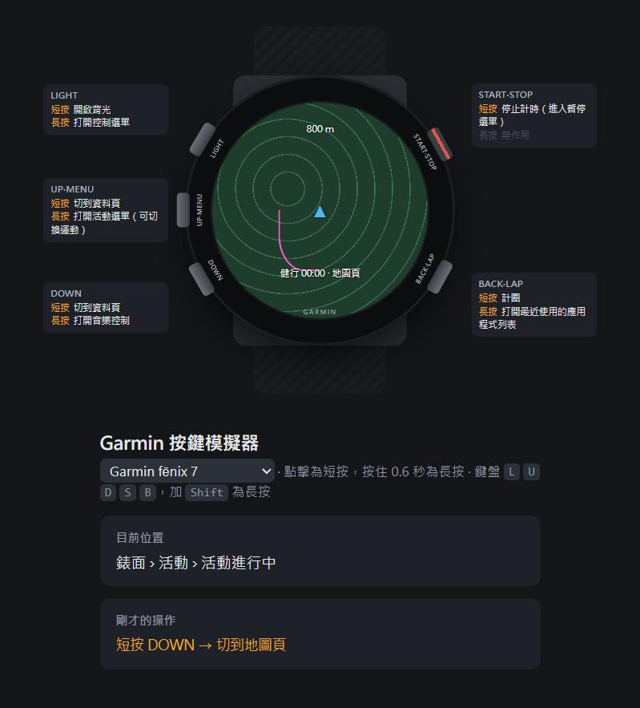

# Garmin 按鍵模擬器 · Garmin Button Simulator

**▶ 線上試用 / Live demo：<https://ioksengtan.github.io/watch_sim/>**

忘記 Garmin 手錶該按哪顆鍵嗎？這是一個網頁版的手錶模擬器：點擊錶身四周的實體按鍵，螢幕就會切到對應的下一個畫面，用「操作即回饋」的方式複習按鍵邏輯，不用戴著錶瞎按。

*A browser-based simulator for Garmin's five-button interface. Click (or long-press) the buttons around the watch and the screen moves to the next state, so you can relearn which button does what without fumbling on the real device. The UI is in Traditional Chinese.*



## 功能

- **五顆實體鍵**：點擊為短按，按住 0.6 秒為長按。
- **每顆鍵旁邊的即時說明**：顯示在目前畫面下，短按和長按各會做什麼。
- **目前位置與操作記錄**：隨時看得到自己在選單的哪一層、剛才那一下做了什麼。
- **可切換型號**：用標題下方的下拉選單，或在網址加上 `?model=fenix7`。
- **鍵盤操作**：`L` `U` `D` `S` `B` 對應 LIGHT / UP / DOWN / START / BACK，加 `Shift` 為長按。

## 支援型號

| 型號 | 涵蓋的流程 | 資料來源 |
| --- | --- | --- |
| Forerunner 255 | 換錶面、小工具一覽、主選單、控制選單、音樂控制、活動開始／計圈／暫停／儲存 | 官方手冊（按鍵總覽、機身圖、各操作步驟） |
| fēnix 7 | 以上全部，加上最近使用列表、離線地圖的平移／縮放、活動中的地圖頁 | 官方手冊（Device Overview、機身圖、Viewing the Map、活動開始／停止） |

### 常見操作速查

| 想做的事 | 按法 |
| --- | --- |
| 換錶面 | 錶面 → 長按 UP → 錶面 → UP/DOWN 預覽 → START → 套用 |
| 看小工具 | 錶面 → UP 或 DOWN |
| 開控制選單 | 任何畫面 → 長按 LIGHT |
| 開始活動 | 錶面 → START → 選活動 → START |
| 平移／縮放地圖（fēnix 7） | 地圖 → 長按 MENU → 平移／縮放 → UP/DOWN，START 切換模式 |

## 準確度說明

按鍵的短按／長按功能與主要操作流程對照了 Garmin 官方手冊。手冊沒有寫明的部分是推測的，可能與實錶不同：

- 選單項目的順序、預設的小工具與活動清單。
- 螢幕內的畫面是簡化示意，不是實機截圖；地圖是示意的等高線圖。
- 中文用詞不一定與手錶上的官方翻譯一致。
- 尚未模擬觸控操作與「快按兩下」這類手勢；許多選單項目只是佔位。

發現與實錶不符的地方，歡迎開 issue 或直接修改型號資料檔。

## 本機執行

純靜態網頁，沒有建置步驟，也沒有相依套件。

```bash
python -m http.server 8255
```

然後開啟 <http://localhost:8255>。

## 專案結構

| 檔案 | 內容 |
| --- | --- |
| `index.html`、`style.css` | 頁面與錶身外觀 |
| `engine.js` | 通用狀態機引擎，不含任何型號知識 |
| `models/fr255.js` | Forerunner 255 的按鍵佈局與「畫面 × 按鍵 → 下一畫面」狀態表 |
| `models/fenix7.js` | fēnix 7，沿用 fr255 的畫面並覆寫差異 |

### 新增型號

1. 在 `models/` 新增一份資料檔，把型號物件掛到 `window.WATCH_MODELS`：包含 `name`、`buttons`（各鍵的角度與標示）、`global`（任何畫面都有效的長按熱鍵）、`screens`（狀態表）。與既有型號相近時可以像 `fenix7.js` 一樣沿用再覆寫。
2. 在 `index.html` 加一行 `<script>` 載入它，下拉選單會自動出現新型號。

## 聲明

本專案為非官方的學習工具，與 Garmin 無關。Garmin、Forerunner、fēnix 為 Garmin Ltd. 或其子公司的商標。
